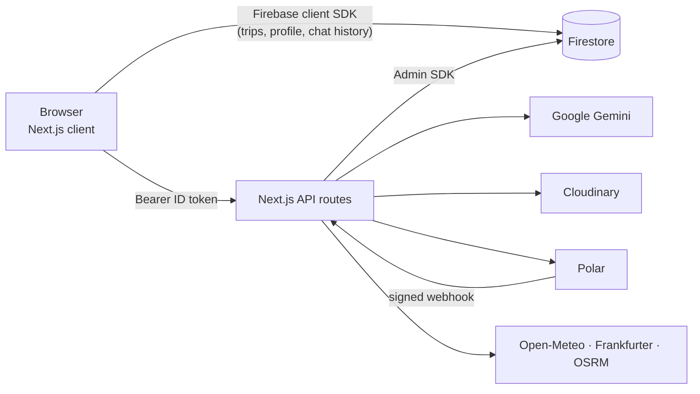

<div align="center">


# Velmora

**Describe a trip. Get the plan.**<br/>
An AI trip planner that turns a plain-language idea into a day-by-day itinerary — places, timings, stays, budget and tips — and lets you reshape any part of it.

<br/>

[](https://velmora-app.vercel.app)


[Features](#-features) · [Screenshots](#-screenshots) · [Quick start](#-quick-start) · [API](#-api-reference) · [Contributing](#-contributing)

</div>

<br/>

## 📑 Table of contents

- [Overview](#-overview)
- [Screenshots](#-screenshots)
- [Features](#-features)
- [Plans and AI credits](#-plans-and-ai-credits)
- [Tech stack](#-tech-stack)
- [Architecture](#-architecture)
- [Project structure](#-project-structure)
- [Quick start](#-quick-start)
- [Environment variables](#-environment-variables)
- [Usage](#-usage)
- [API reference](#-api-reference)
- [Data model](#-data-model)
- [Commands](#-commands)
- [Testing](#-testing)
- [Deployment](#-deployment)
- [Data sources and credits](#-data-sources-and-credits)
- [Contributing](#-contributing)
- [License](#-license)

<br/>

## ✨ Overview

Velmora is a full-stack travel-planning web app. You describe the trip you want — or fill in a short form — and it generates a complete itinerary with Google Gemini: day-by-day activities with timings, places to stay, a budget breakdown and practical tips. From there you can edit the plan, ask the built-in chat assistant to build or change trips for you, track what you actually spend, and share travel stories with other users.

It started as a personal project and runs a real **Free / Pro** subscription model, with AI usage metered by a monthly credit pool that is enforced on the server.

> [!NOTE]
> Velmora was previously named **Prava AI**. Some internal identifiers keep the old name on purpose — for example the `prava-zone` Cloudinary folder that holds already-uploaded images and a few `prava:` browser-storage keys.

<br/>

## 📸 Screenshots

<div align="center">

| Light | Dark |
| :---: | :---: |
|  |  |


</div>

> The screenshots show the public landing page. The signed-in app needs a Firebase account, so it isn't pictured here. The trip preview on the landing page is a sample drawn in markup, not live data.

<br/>

## 🚀 Features

### 🧭 Trip planning

| Feature | What it does |
| --- | --- |
| **AI itineraries** | Generates a day-by-day plan from your trip details: activities with timings, accommodation options, a budget and tips. Replies are validated before they are saved. |
| **Multi-stop trips** | Build a route of several stops and pick how you travel between them: flight, drive, bus, train or ferry. |
| **Budget tracking** | Set one total budget in your chosen currency, with a budget view alongside the plan. |
| **Day-level AI edits** *(Pro)* | Regenerate a single day, or refine it with an instruction such as "more food spots, fewer long walks". |
| **Export** *(Pro)* | Download a trip as **JSON** or as an **`.ics`** calendar file. |
| **Print-friendly view** | The trip page ships print styles. |

### 💬 AI assistant

| Feature | What it does |
| --- | --- |
| **Streaming chat** | Replies stream in as newline-delimited JSON events. |
| **Builds trips through conversation** | Uses Gemini function calling to create a trip from a chat, rather than parsing free text. |
| **Voice input** | Dictation through the browser's Web Speech API, where the browser supports it. |
| **Metered usage** | Every message and plan draws from your monthly AI credits. |

### 🗺️ Discover, tools and insights

| Feature | What it does |
| --- | --- |
| **Discover** | Place search, an interactive Leaflet map, and distance and travel-time estimates between places. |
| **Weather** | Current conditions and a trip-dates forecast for a destination. |
| **Currency converter** | Live exchange rates for travel budgets. |
| **Expense tracker** | Log expenses against custom buckets, optionally linked to a trip, with a spending breakdown. |
| **Emergency contacts** | Emergency numbers by country and region. The data is compiled from public sources and can go out of date, so double-check a number before relying on it. |
| **Insights** | Charts of your spending and trips, plus a budget-goal card. |

### 📝 Zone — the travel blog

| Feature | What it does |
| --- | --- |
| **Posts** | Write travel posts with a category and multiple images (uploaded to Cloudinary). |
| **Community** | Comments, likes and per-author pages. |
| **Discovery** | Search, filter by category, and sort by newest, most liked or most commented. |
| **Verified badge** *(Pro)* | A badge next to Pro members' posts and comments. |

### 🔐 Accounts and billing

| Feature | What it does |
| --- | --- |
| **Sign-in** | Email and password (with password reset) or Google, through Firebase Auth. |
| **Unique usernames** | A live availability check during sign-up, then a short onboarding step. |
| **Subscriptions** | Polar-hosted checkout, a customer portal, signed webhooks, and a sync fallback for missed webhooks. |
| **Theming** | Light and dark mode. |

<br/>

## 💎 Plans and AI credits

Every limit lives in one file, [`lib/plans.js`](lib/plans.js). The UI, the API routes and the webhook all read from it, so a number is never written twice.

| | 🆓 **Free Explorer** | ⭐ **Pro Wanderer** |
| --- | :---: | :---: |
| **Price** | ₹0 | ₹200 / month or ₹2,000 / year |
| **AI credits per month** | 30 | 150 |
| **Saved trips** | 10 | 25 |
| **Stops per trip** | 3 | 6 |
| **Days per trip** | 10 | 21 |
| **Trip plans built by the chat assistant** | 2 / month | Limited only by credits |
| **Full itinerary regeneration** | — ¹ | ✅ |
| **Regenerate or refine a single day** | — | ✅ |
| **JSON and calendar export** | — | ✅ |
| **Verified creator badge** | — | ✅ |
| **Early access to new features** | — | ✅ |

¹ Free accounts can still regenerate when they have changed the route, since the old plan would otherwise be wrong.

**What an AI action costs**

| Action | Credits |
| --- | :---: |
| Chat message | 1 |
| Regenerate a single day | 1 |
| Refine a day with an instruction | 2 |
| Generate a full itinerary | 5 |
| Build a full itinerary from chat | 5 |

The credit pool resets when the calendar month changes in **IST (Asia/Kolkata)**. Credits are reserved on the server before an AI call and refunded if the call fails.

<br/>

## 🧰 Tech stack

| Layer | Technology |
| --- | --- |
| **Framework** | [Next.js 16](https://nextjs.org) (App Router) with the React Compiler enabled, [React 19](https://react.dev) |
| **Styling** | [Tailwind CSS 4](https://tailwindcss.com), [next-themes](https://github.com/pacocoursey/next-themes), [Framer Motion](https://www.framer.com/motion/) |
| **UI** | [lucide-react](https://lucide.dev), [react-icons](https://react-icons.github.io/react-icons/), [sonner](https://sonner.emilkowal.ski) toasts, [react-markdown](https://github.com/remarkjs/react-markdown) with remark-gfm |
| **Auth and data** | [Firebase](https://firebase.google.com) Auth and Firestore (client SDK), [Firebase Admin](https://firebase.google.com/docs/admin/setup) on the server |
| **AI** | [Google Gemini](https://ai.google.dev) through [`@google/genai`](https://www.npmjs.com/package/@google/genai) |
| **Payments** | [Polar](https://polar.sh), called over plain `fetch` (no SDK) |
| **Media** | [Cloudinary](https://cloudinary.com) for Zone image uploads |
| **Maps and charts** | [Leaflet](https://leafletjs.com) with OpenStreetMap tiles, [Recharts](https://recharts.org) |
| **Testing** | Node's built-in test runner (`node:test`) |
| **Hosting** | [Vercel](https://vercel.com) |

<br/>

## 🧱 Architecture



A few design choices worth knowing about:

- **Logic lives in `lib/` and imports no React.** That is what lets the whole test suite run under `node --test` with no bundler and no DOM.
- **Server routes verify identity, never trust the client.** Protected routes verify a Firebase ID token and build the author identity from the *verified* token, not the request body.
- **Plan state is written only by the payment webhook** (through the Admin SDK), never by the browser.
- **AI calls are metered before they run.** Credits are reserved first and refunded on failure. Itinerary generation is also rate-limited to 10 per hour per account.
- **Model fallback.** AI routes try `GEMINI_MODEL` (default `gemini-3.8-flash`), then fall back to `gemini-3.5-flash-lite`.

<br/>

## 📂 Project structure

```text
velmora/
├── app/
│   ├── (dashboard)/          Signed-in pages
│   │   ├── dashboard/        Home
│   │   ├── trips/            List, new, [id] details, [id]/edit
│   │   ├── assistant/        AI chat
│   │   ├── discover/         Place search and map
│   │   ├── tools/            Currency, expenses, emergency contacts
│   │   ├── insights/         Spending and trip charts
│   │   ├── zone/             Travel blog: feed, post, author, new, edit
│   │   └── subscription/     Plans and billing
│   ├── api/                  Route handlers (see API reference)
│   ├── login/ signup/ onboarding/
│   ├── layout.js  page.js  globals.css
├── components/               UI, grouped by feature
│   ├── Marketing/            Landing page sections
│   ├── trips/  assistant/  zone/  tools/  insights/  billing/  …
│   └── ui/                   Shared primitives (Button, Card, Modal, …)
├── context/                  AuthContext, WeatherContext
├── hooks/                    Data fetching and local state
├── lib/                      Business logic (React-free)
│   ├── assistant/            Prompts, streaming, credit accounting
│   ├── billing/              Polar checkout, webhook, sync
│   ├── trips/                Day edits, export
│   ├── zone/                 Posts, uploads, rate limiting
│   ├── auth/  tools/
│   ├── plans.js              The one source of truth for plan limits
│   └── brand.js              The product name, in one place
├── tests/                    node:test suites, mirroring lib/
├── public/                   Favicon and icons
├── docs/screenshots/         README images
├── firestore.indexes.json    Composite indexes for Zone
└── .env.example              Environment variable template
```

<br/>

## ⚡ Quick start

### Prerequisites

- **Node.js 22** — `package.json` pins `engines.node` to `22.x`. See [Deployment](#-deployment) for why the version matters.
- A **Firebase** project with Authentication and Firestore enabled
- A **Google Gemini** API key
- *Optional:* a Cloudinary account (Zone image uploads) and a Polar account (subscriptions)

### 1. Clone and install

```bash
git clone https://github.com/PrathameshBhosale01/Velmora.git
cd Velmora
npm install
```

### 2. Set up Firebase

1. In the [Firebase console](https://console.firebase.google.com), create a project and add a **Web app**. Its config gives you the six `NEXT_PUBLIC_FIREBASE_*` values.
2. Under **Authentication → Sign-in method**, enable **Email/Password** and **Google**.
3. Under **Authentication → Settings → Authorized domains**, add every domain you will serve the app from. `localhost` is there by default.
4. Create a **Firestore** database.
5. Under **Project settings → Service accounts**, generate a private key. Its `project_id`, `client_email` and `private_key` become the three server-side `FIREBASE_*` values.
6. Create the composite indexes Zone needs. They are listed in [`firestore.indexes.json`](firestore.indexes.json) (collection `blog_posts`). You can create them in the console, or deploy the file with your own `firebase.json`.

> [!IMPORTANT]
> **Firestore Security Rules are not included in this repository.** Trips, activities, profiles and chat history are read and written from the browser with the Firebase client SDK, so you must write rules that scope each document to its owner. Plan and credit fields on a user document (such as `subscription` and `aiCredits`) are meant to be written only by the server, so your rules should deny client writes to them.

### 3. Configure environment variables

```bash
cp .env.example .env.local
```

Fill in the values — see [Environment variables](#-environment-variables).

### 4. Run it

```bash
npm run dev
```

Open [http://localhost:3000](http://localhost:3000).

<br/>

## 🔑 Environment variables

Copy [`.env.example`](.env.example) to `.env.local`. Variables prefixed with `NEXT_PUBLIC_` are bundled into the browser; everything else stays on the server. **Never commit `.env.local`.**

### Required

| Variable | Used for |
| --- | --- |
| `NEXT_PUBLIC_FIREBASE_API_KEY` | Firebase web config |
| `NEXT_PUBLIC_FIREBASE_AUTH_DOMAIN` | Firebase web config |
| `NEXT_PUBLIC_FIREBASE_PROJECT_ID` | Firebase web config |
| `NEXT_PUBLIC_FIREBASE_STORAGE_BUCKET` | Firebase web config |
| `NEXT_PUBLIC_FIREBASE_MESSAGING_SENDER_ID` | Firebase web config |
| `NEXT_PUBLIC_FIREBASE_APP_ID` | Firebase web config |
| `FIREBASE_PROJECT_ID` | Firebase Admin credentials |
| `FIREBASE_CLIENT_EMAIL` | Firebase Admin credentials |
| `FIREBASE_PRIVATE_KEY` | Firebase Admin credentials. Wrap it in double quotes and keep the `\n` escapes; the app converts them to real newlines. |
| `GEMINI_API_KEY` | Itinerary generation and the chat assistant |

### Optional

| Variable | Default | Used for |
| --- | --- | --- |
| `GEMINI_MODEL` | `gemini-3.8-flash` | Overrides the primary model. The fallback is `gemini-3.5-flash-lite`. |
| `CLOUDINARY_CLOUD_NAME` | — | Zone image uploads |
| `CLOUDINARY_API_KEY` | — | Zone image uploads |
| `CLOUDINARY_API_SECRET` | — | Zone image uploads. Uploads are disabled unless all three Cloudinary values are set. |
| `POLAR_ACCESS_TOKEN` | — | Creating checkouts and customer-portal sessions |
| `POLAR_WEBHOOK_SECRET` | — | Verifying the `whsec_…` signature on webhooks |
| `POLAR_PRODUCT_MONTHLY` | — | Polar product ID for the monthly plan |
| `POLAR_PRODUCT_YEARLY` | — | Polar product ID for the yearly plan |
| `POLAR_SERVER` | `sandbox` | `sandbox` or `production` |
| `NEXT_PUBLIC_APP_URL` | request origin | Where Polar sends people back after checkout. Set it behind a proxy or tunnel. |
| `NEXT_PUBLIC_MAP_TILE_URL` | OpenStreetMap | Map tile provider |
| `NEXT_PUBLIC_MAP_ATTRIBUTION` | OpenStreetMap | Map attribution text |
| `OSRM_BASE_URL` | `https://router.project-osrm.org` | Routing server |
| `NEXT_PUBLIC_FEEDBACK_EMAIL` | the maintainer's address | Where the "Share feedback" link sends mail |

> [!TIP]
> To develop without billing, leave the Polar variables empty. Upgrade and checkout won't work, but everything else will.

<br/>

## 📖 Usage

1. **Sign up** with email or Google, choose a unique username, and pick your travel interests.
2. **Create a trip** from *Trips → New*: a title, category, route stops, budget and currency, number of travellers, start date, and your accommodation and transport preferences.
3. **Generate the itinerary.** Open the trip and generate the plan. It costs 5 credits.
4. **Refine it.** Edit the trip, or — on Pro — regenerate or refine a single day with a short instruction.
5. **Ask the assistant.** Open *Assistant* and describe a trip in chat; it can build the trip for you.
6. **Track spending.** In *Tools → Expenses*, log what you spend into buckets and compare it against your budget in *Insights*.
7. **Share a story.** Post to *Zone* with photos and a category.
8. **Upgrade.** *Subscription* shows your plan, remaining credits and billing, with checkout and a customer portal.

<br/>

## 📡 API reference

All routes are Next.js route handlers under `app/api`. **Auth** means the request must carry `Authorization: Bearer <Firebase ID token>`.

### Assistant

| Method | Endpoint | Auth | Description |
| --- | --- | :---: | --- |
| `POST` | `/api/assistant/chat` | ✅ | Chat with the assistant. Body: `{ messages: [{ role, content }] }`. Responds with an `application/x-ndjson` stream. |
| `GET` | `/api/assistant/usage` | ✅ | Remaining monthly AI credits for the signed-in user. |

### Trips

| Method | Endpoint | Auth | Description |
| --- | --- | :---: | --- |
| `POST` | `/api/trips/:id/itinerary` | ✅ | Generate (or regenerate) the itinerary for a trip you own. Credits are reserved up front. |
| `POST` | `/api/trips/:id/itinerary/day` | ✅ | Regenerate or refine one day. Body: `{ day: number, instruction?: string }`. Pro only. |

### Accounts

| Method | Endpoint | Auth | Description |
| --- | --- | :---: | --- |
| `POST` | `/api/auth/signup` | — | Create an account. Body: `{ email, password, name, username, interests }`. |
| `POST` | `/api/auth/profile` | ✅ | Complete or update a profile. Body: `{ name, username, interests }`. |
| `GET` | `/api/auth/username?u=name` | — | Check whether a username is free. Returns `{ available, reason? }`. |

### Billing

| Method | Endpoint | Auth | Description |
| --- | --- | :---: | --- |
| `POST` | `/api/billing/checkout` | ✅ | Start a Polar checkout. Body: `{ interval: "month" \| "year" }`. |
| `POST` | `/api/billing/portal` | ✅ | Open the Polar customer portal. |
| `POST` | `/api/billing/sync` | ✅ | Ask Polar for your subscription and save it. A fallback for a missed webhook. |
| `POST` | `/api/billing/webhook` | signature | Called by Polar. Verified with `POLAR_WEBHOOK_SECRET`, not a user token. |

### Zone

| Method | Endpoint | Auth | Description |
| --- | --- | :---: | --- |
| `GET` | `/api/zone/posts` | ✅ | List posts. Query: `q`, `category`, `author`, `sort=new\|likes\|comments`, `cursor`, `limit`. Returns `{ posts, nextCursor }`. |
| `POST` | `/api/zone/posts` | ✅ | Create a post. Body: `{ title, content, category, imageUrls?, coverIndex? }`. |
| `GET` `PATCH` `DELETE` | `/api/zone/posts/:id` | ✅ | Read, edit or delete a post. |
| `GET` `POST` | `/api/zone/posts/:id/comments` | ✅ | List comments, or add one with `{ text }`. |
| `PATCH` `DELETE` | `/api/zone/posts/:id/comments/:commentId` | ✅ | Edit or delete a comment. |
| `PUT` | `/api/zone/posts/:id/like` | ✅ | Like or unlike. Body: `{ liked: boolean }`. Idempotent. |
| `POST` | `/api/zone/upload` | ✅ | Upload an image (`multipart/form-data`, field `file`). Returns `{ url, width, height }`. |

### Travel tools

| Method | Endpoint | Auth | Description |
| --- | --- | :---: | --- |
| `GET` `POST` | `/api/tools/expenses` | ✅ | List your expenses and buckets, or add an expense. |
| `PATCH` `DELETE` | `/api/tools/expenses/:id` | ✅ | Edit or delete an expense. |
| `POST` | `/api/tools/expense-buckets` | ✅ | Create a bucket. Body: `{ title }`. |
| `DELETE` | `/api/tools/expense-buckets/:id` | ✅ | Delete a bucket. Its expenses move to *General*. |

### Maps, weather and currency

| Method | Endpoint | Auth | Description |
| --- | --- | :---: | --- |
| `GET` | `/api/places?q=goa` | — | Place autocomplete for the route builder. |
| `GET` | `/api/geocode?destination=` | — | Geocode a destination. |
| `GET` | `/api/route` | — | Road route between two points. Query: `fromLat`, `fromLng`, `toLat`, `toLng`. |
| `GET` | `/api/weather?destination=&startDate=&duration=` | — | Forecast for a trip's dates. |
| `GET` | `/api/weather/current?city=` | — | Current weather by city, or by `lat` and `lon`. |
| `GET` | `/api/currency?from=&to=` | — | Exchange rate between two currencies. |
| `GET` | `/api/currency/rates` | — | The full rate table. |

<br/>

## 💾 Data model

Firestore collections used by the app:

| Collection | Holds |
| --- | --- |
| `users` | Profile, plan state (`subscription`) and AI credit usage (`aiCredits`) |
| `usernames` | Unique-username reservations |
| `trips` | Trips and their generated itineraries |
| `users/{uid}/activities` | A per-user activity log, shown as *Recent activity* on the dashboard |
| `expenses` · `expense_buckets` | Expense tracker data |
| `blog_posts` · `comments` · `likes` | Zone content |
| `zone_rate_limits` | Rate-limit counters |

<br/>

## 🔧 Commands

| Command | What it does |
| --- | --- |
| `npm run dev` | Start the development server on port 3000 |
| `npm run build` | Create a production build |
| `npm start` | Serve the production build |
| `npm run lint` | Run ESLint |
| `npm test` | Run the `node:test` suite |

<br/>

## ✅ Testing

```bash
npm test
```

Tests live in `tests/`, mirror the layout of `lib/`, and run on Node's built-in test runner — no bundler, browser or Firebase connection needed, because the logic they cover is React-free. They cover plans and credits, billing and webhooks, trips, the assistant, auth validation, Zone and the expense tools.

At the time of writing, **436 tests run: 435 pass and 1 fails.** The failing test is *"deleting a bucket keeps its expenses and moves them to General"* in `tests/tools/expenseService.test.mjs`.

<br/>

## 🚢 Deployment

Velmora is built for [Vercel](https://vercel.com).

1. Import the repository and add the [environment variables](#-environment-variables) in **Project → Settings → Environment Variables**. Server-side variables are separate from the `NEXT_PUBLIC_*` ones, so check both.
2. In Firebase, add your deployment domain under **Authentication → Settings → Authorized domains**. Without it, Google sign-in is blocked.
3. In Polar, point the webhook at `https://<your-domain>/api/billing/webhook` — the full path, not the site root — and set `POLAR_WEBHOOK_SECRET` to match.
4. Production deploys come from the branch your Vercel project is set to track. Other branches create preview deployments with their own URLs.

> [!WARNING]
> **Node version.** `firebase-admin` depends on `jose`, which is ESM-only from version 6. Loading it from CommonJS needs Node 22.12+ (or 20.19+); on older runtimes every authenticated API route fails with `ERR_REQUIRE_ESM`. This repo pins `engines.node` to `22.x` and uses an npm `overrides` entry to hold `jose` at `5.10.0`. Keep `package-lock.json` committed, so installs stay in step with `package.json`.

<br/>

## 🌍 Data sources and credits

| Service | Used for |
| --- | --- |
| [Open-Meteo](https://open-meteo.com) | Place search (geocoding) and weather forecasts |
| [Frankfurter](https://frankfurter.dev) | Currency exchange rates |
| [OSRM](https://project-osrm.org) | Road routing |
| [OpenStreetMap](https://www.openstreetmap.org/copyright) | Map tiles and data © OpenStreetMap contributors |
| [BigDataCloud](https://www.bigdatacloud.com) | Reverse geocoding |

<br/>

## 🤝 Contributing

Contributions are welcome. For anything larger than a small fix, please open an issue first so we can agree on the approach.

1. **Fork** the repository and create a branch from `main`:
   ```bash
   git checkout -b feat/your-change
   ```
2. **Set up** locally by following the [quick start](#-quick-start).
3. **Read `AGENTS.md` before touching framework code.** This project uses Next.js 16, whose APIs and conventions differ from older versions. The docs for the installed version are in `node_modules/next/dist/docs/`.
4. **Keep logic in `lib/`.** Put business logic in plain, React-free modules so it stays testable, and keep UI in `components/`.
5. **Add tests** for logic you change or add, under `tests/`, mirroring the path in `lib/`.
6. **Make sure checks pass** before you open a pull request:
   ```bash
   npm run lint
   npm test
   ```
7. **Open a pull request** that explains what changed and why, and link the related issue.

Please don't commit secrets or `.env.local`. If you find a security problem, report it privately to the maintainer instead of opening a public issue.

<br/>

## 📄 License

This repository does not include a license file yet, so no license is granted by default. If you plan to reuse the code, please contact the maintainer first.

<br/>

<div align="center">

**Built by [Prathamesh Bhosale](https://github.com/PrathameshBhosale01)**

[⬆ Back to top](#velmora)

</div>
